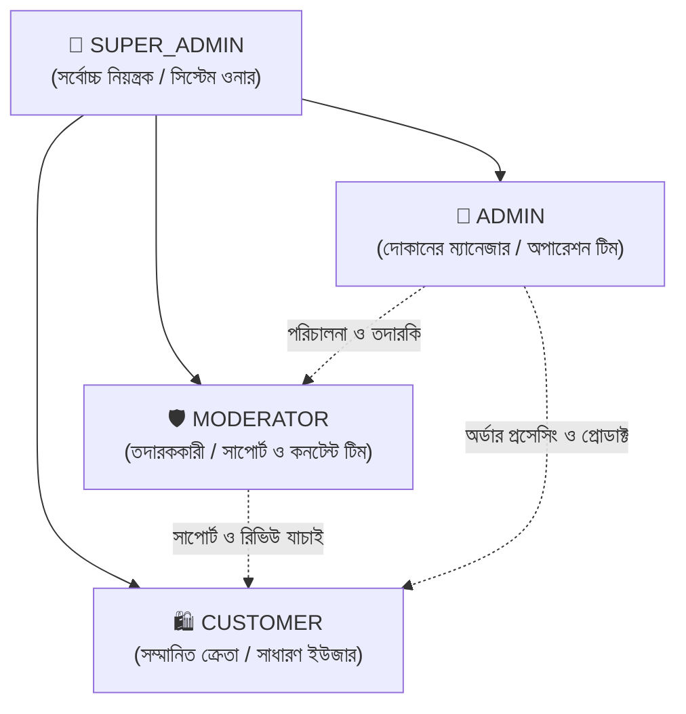
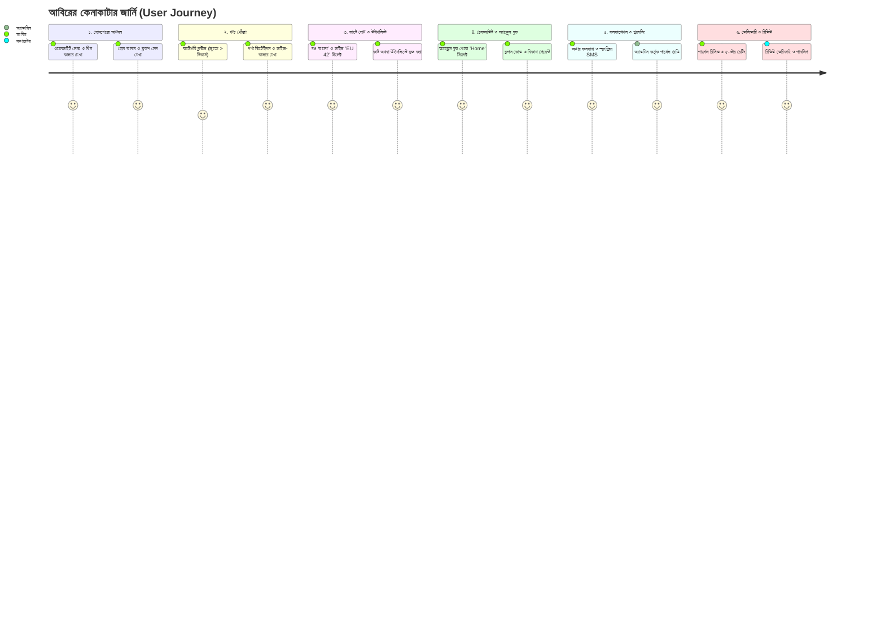

# 🛒 সহজ ভাষায় আমাদের ই-কমার্স সিস্টেম ও ডাটাবেজ গাইড

এই ডকুমেন্টে আমাদের ই-কমার্স ওয়েবসাইটের প্রতিটি টেবিল (মডেল) কেন তৈরি করা হয়েছে তা একদম সহজ ভাষায় (ক্লাস ৫-এর বাচ্চার মতো সুন্দর উপমা দিয়ে) বুঝিয়ে দেওয়া হয়েছে। ডকুমেন্টের শেষ অংশে রয়েছে একজন সাধারণ ক্রেতার শুরু থেকে শেষ পর্যন্ত কেনাকাটার গল্প (User Journey)।

---

## 🏬 পর্ব ১: কোন টেবিলের কী কাজ? (একটি বড় সুপারশপের গল্প)

মনে করো আমরা একটি অনেক বড় আধুনিক সুপারশপ বানিয়েছি। এই দোকানে সব কাজ নিয়মমাফিক করার জন্য অনেকগুলো আলাদা খাতা (টেবিল) রাখা হয়েছে।

---

### ১. `users` (গ্রাহক, মডারেটর ও অ্যাডমিনদের তালিকা খাতা)

- **সহজ উপমা**: স্কুলের সেন্ট্রাল আইডি কার্ড ও রেজিস্টার খাতা।
- **কাজ**: সিস্টেমের প্রতিটি মানুষের মূল পরিচিতি (আইডেন্টিটি) এখানে সুরক্ষিত থাকে।
- **৪টি মূল রোল (Roles)**:
  - 👑 **`super_admin`**: দোকানের মূল মালিক বা প্রধান প্রযুক্তি নিয়ন্ত্রক।
  - 🏢 **`admin`**: দোকানের প্রধান ম্যানেজার (অপারেশন ও ইনভেন্টরি পরিচালক)।
  - 🛡️ **`moderator`**: কনটেন্ট, কাস্টমার রিভিউ ও অর্ডার তদারককারী সুপারভাইজার।
  - 🛍️ **`customer`**: আমাদের সম্মানিত ক্রেতা।
- **নিরাপত্তা ও অন্যান্য তথ্য**: ইমেইল, হ্যাশ করা পাসওয়ার্ড, ফোন নম্বর, অ্যাকাউন্ট স্ট্যাটাস (`ACTIVE`, `BLOCKED`, `DELETED`), ওটিপি যাচাই (`isOtpVerified`), ২-স্টেপ ভেরিফিকেশন (2FA) এবং অ্যাকাউন্ট ব্লক/ডিলিট করার কারণ এখানে রেকর্ড থাকে।

---

### ২. `categories` (দোকানের আলমারি ও তাক)

- **সহজ উপমা**: একটা বড় আলমারির ভেতরের ছোট ছোট তাক।
- **কাজ**: দোকানে পণ্য সাজিয়ে রাখা।
  - মূল তাক: **ছেলেদের পোশাক**
  - তার ভেতরের ছোট তাক: **প্যান্ট**
  - তার ভেতরে আরও ছোট তাক: **জিন্স প্যান্ট**
- এভাবে এক তাকের ভেতর আরেক তাক (নেস্টেড ক্যাটাগরি) খুব সহজে সাজানো থাকে।

---

### ৩. `products` (শোকেসের ডিসপ্লে পণ্য)

- **সহজ উপমা**: দোকানের শোকেসে রাখা ডেমো বা পুতুলের গায়ে পরানো জামা।
- **কাজ**: এটা দেখে কাস্টমার বুঝতে পারে পণ্যটার নাম কী, কেমন দেখতে এবং এর বিবরণ কী। যেমন: _"নাইকি রানিং শু"_ বা _"কটন পোলো টি-শার্ট"_।

---

### ৪. `attributes` ও `attribute_values` (মাপ ও রঙের তালিকা)

- **সহজ উপমা**: দর্জির ফিতা এবং রঙের প্যালেট।
- **`attributes`**: মাপের ধরন (যেমন: জামার সাইজ, জুতোর সাইজ, রঙ)।
- **`attribute_values`**: আসল মাপ বা রঙ (যেমন: লালা, নীল, 'XL', জুতোর জন্য 'EU 42')।

---

### ৫. `product_variants` (আসল জুতো বা জামার বাক্স)

- **সহজ উপমা**: গুদামের তাকে রাখা আসল কার্টন বা জুতো-জামা ভর্তি বাক্স।
- **কাজ**: শোকেসের পুতুলের জামা তো আর বিক্রি করা যায় না! বিক্রি করতে হয় আসল বাক্স থেকে।
  - এই টেবিলে লেখা থাকে: _"কালো রঙের ৪২ সাইজের জুতো কয়টা আছে (স্টক)"_ এবং _"তার দাম কত"_।
  - প্রতিটি বাক্সের গায়ে একটি ইউনিক বারকোড (SKU) থাকে।

---

### ৬. `variant_attribute_values` (বাক্সের গায়ে লাগানো লেবেল)

- **সহজ উপমা**: বাক্সের ওপর লিখে রাখা চিরকুট।
- **কাজ**: বাক্সের সাথে রঙ আর সাইজকে আঠা দিয়ে লাগিয়ে দেওয়া (যেমন: বাক্স নং ০১ = লাল রঙ + সাইজ XL)।

---

### ৭. `product_images` (পণ্যের ছবির অ্যালবাম)

- **সহজ উপমা**: পণ্যের সুন্দর সুন্দর ফটোগ্রাফ।
- **কাজ**: লাল টি-শার্টের ছবি, নীল টি-শার্টের ছবি এবং পেছনের ছবিগুলো এখানে জমা থাকে। এর সাথে গুগল সার্চের জন্য ছবির নাম (Alt Text) লেখা থাকে।

---

### ৮. `flash_sales` ও `flash_sale_items` (ধামাকা অফার ও বিশেষ ছাড়)

- **সহজ উপমা**: মাইকিং করে বলা—_"আজ রাত ৮টা থেকে ১০টা পর্যন্ত অর্ধেক দামে জুতো বিক্রি হবে!"_
- **কাজ**: নির্দিষ্ট সময়ের জন্য বিশেষ ছাড় চালু করা এবং সর্বোচ্চ কয়টা পণ্য ছাড়ে বিক্রি হবে তা নিয়ন্ত্রণ করা। সময় শেষ হলে দাম আবার আগের মতো হয়ে যায়।

---

### ৯. `banners` (দোকানের সামনে ঝোলানো বড় পোস্টার)

- **সহজ উপমা**: দোকানের প্রবেশমুখে টানানো রঙিন বিজ্ঞাপন বোর্ড।
- **কাজ**: ওয়েবসাইটে ঢুকলেই যেন বড় বড় ব্যানারে অফার, নতুন কালেকশন বা ঈদ সেল দেখতে পাওয়া যায়।

---

### ১০. `carts` ও `cart_items` (কেনাকাটার ট্রলি বা ঝুড়ি)

- **সহজ উপমা**: সুপারশপে ঢোকার সময় হাতে নেওয়া চাকাওয়ালা ট্রলি।
- **কাজ**: পছন্দের পণ্যগুলো কেনার আগে ট্রলিতে জমিয়ে রাখা।
  - মেম্বার কাস্টমার হলে তার নামে ট্রলি জমা থাকে।
  - অচেনা অতিথি (Guest) কাস্টমার হলে তার হাতে একটি টোকেন ধরিয়ে দিয়ে সাময়িক ট্রলি দেওয়া হয়।

---

### ১১. `orders` ও `order_items` (দোকানের পাকা ক্যাশ মেমো)

- **সহজ উপমা**: কেনাকাটা শেষে ক্যাশিয়ারের দেওয়া পাকা রসিদ।
- **`orders`**: রসিদের ওপরের অংশ—কার অর্ডার, ফোন নম্বর, ঠিকানা এবং মোট কত টাকা বিল হলো।
- **`order_items`**: রসিদের ভেতরের তালিকা—কাস্টমার ঠিক কী কী পণ্য, কোন রঙের, কোন সাইজের এবং কত দামে কিনেছেন তার চিরস্থায়ী রেকর্ড।

---

### ১২. `payments` (ক্যাশিয়ারের টাকা জমার খাতা)

- **সহজ উপমা**: ব্যাংকের জমার স্লিপ।
- **কাজ**: টাকা কি নগদে ক্যাশ অন ডেলিভারি (COD) হবে, নাকি বিকাশ/SSLCommerz দিয়ে আগেই দেওয়া হয়েছে—তার ট্রানজ্যাকশন আইডি ও জমার হিসাব রাখা।

---

### ১৩. `order_notifications` (খবর পাঠানো পোস্টম্যান বা ডাকপিয়ন)

- **সহজ উপমা**: মোবাইলে আসা কনফার্মেশন চিঠি/এসএমএস।
- **কাজ**: অর্ডার হওয়ার সাথে সাথে কাস্টমারের মোবাইলে স্বয়ংক্রিয়ভাবে মেসেজ চলে যায়: _"আপনার অর্ডারটি সফল হয়েছে! ডেলিভারি টিম কাজ করছে।"_

---

### ১৪. `audit_logs` (দোকানের সিসিটিভি ক্যামেরা ও কাজের ডায়েরি)

- **সহজ উপমা**: সিসিটিভি ক্যামেরার ভিডিও রেকর্ড।
- **কাজ**: কোনো অ্যাডমিন বা কর্মী যদি কোনো পণ্যের দাম বা স্টক পরিবর্তন করে, তবে সেটার তারিখ ও সময়সহ প্রমাণ রেখে দেওয়া—যাতে কোনো গরমিল না হয়।

---

### ১৫. `site_settings` (দোকানের দেয়ালের রঙ বদলানোর রিমোট)

- **সহজ উপমা**: দোকানের লাইট ও সাজসজ্জা বদলানোর সুইচ।
- **কাজ**: ওয়েবসাইট রি-বিল্ড বা কোড পরিবর্তন না করেই অ্যাডমিন প্যানেল থেকে ওয়েবসাইটের থিম বা বাটনের রঙ মুহূর্তেই বদলে ফেলা।

---

### ১৬. `coupons` ও `coupon_usages` (জাদুকরী ডিসকাউন্ট কুপন ও ব্যবহারের হিসাব)

- **সহজ উপমা**: দোকানে দেওয়া বিশেষ গিফট ভাউচার বা ডিসকাউন্ট কুপন কার্ড।
- **কাজ**:
  - **`coupons`**: যেমন—`EID50` বা `WELCOME10` কোড লিখলে ১০% বা ২০০ টাকা ছাড় পাওয়া যাবে। এখানে ছাড়ের মেয়াদ, ন্যূনতম কত টাকার পণ্য কিনতে হবে এবং সর্বোচ্চ কয়বার ব্যবহার করা যাবে তা লেখা থাকে।
  - **`coupon_usages`**: একজন কাস্টমার বা একটি মোবাইল নম্বর দিয়ে একই প্রোমো কোড বারবার চুরি করে বা প্রতারণা করে যেন ব্যবহার করতে না পারে, তার কড়া নজরদারি ও হিসেবের খাতা।

---

### ১৭. `addresses` (গ্রাহকের ঠিকানার ডায়েরি / Address Book)

- **সহজ উপমা**: কাস্টমারের ব্যক্তিগত ডায়রি যাতে বাসা, অফিস বা গ্রামের বাড়ির ঠিকানা সুন্দরভাবে লিখে রাখা থাকে।
- **কাজ**: একই কাস্টমার যেন একাধিক ডেলিভারি ও বিলিং ঠিকানা সেভ রাখতে পারে:
  - **লেবেল**: যেমন—`HOME`, `OFFICE`, `OTHER`।
  - **ঠিকানার বিবরণ**: প্রাপকের নাম (`recipient_name`), ফোন নম্বর (`phone`), বিকল্প ফোন (`alt_phone`), বিভাগ (`division`), জেলা (`district`), থানা/উপজেলা (`thana`), এবং বিস্তারিত সড়কের বর্ণনা (`street_address`)।
  - **ডিফল্ট অপশন**: `is_default_shipping` ও `is_default_billing` যাতে চেকআউটের সময় বারবার নতুন করে হাত দিয়ে ঠিকানা লিখতে না হয়; ১-ক্লিকেই পছন্দের ঠিকানায় পার্সেল চলে যায়।

---

### ১৮. `user_profiles` (গ্রাহকের অতিরিক্ত তথ্য ও মেম্বারশিপ পরিচিতি)

- **সহজ উপমা**: ক্লাবের মেম্বারশিপ কার্ড বা বায়োডাটা ফরম।
- **কাজ**: মূল `users` টেবিলকে হালকা ও ফাস্ট রাখার জন্য ইউজারের অতিরিক্ত তথ্য এখানে আলাদা রাখা হয়।
  - যেমন: জন্মতারিখ (জন্মদিনে স্পেশাল কুপন পাঠানোর জন্য), লিঙ্গ, প্রোফাইল ছবি (Cloudinary URL), পছন্দের ভাষা বা কারেন্সি প্রেফারেন্স।

---

### ১৯. `product_reviews` ও `review_moderations` (ক্রেতার মতামত ও মডারেটরের যাচাই খাতা)

- **সহজ উপমা**: দোকানের পাবলিক ভিজিটরস বুক ও ফিডব্যাক বক্স।
- **কাজ**:
  - **`product_reviews`**: শুধুমাত্র আসল ক্রেতারা ডেলিভারি পাওয়ার পর পণ্যের রেটিং (১ থেকে ৫ স্টার), লিখিত রিভিউ ও ছবির প্রমাণ আপলোড করতে পারে।
  - **`review_moderations`**: কোনো অসাধু ব্যক্তি যেন গালিগালাজ, ভুয়া প্রচারণা বা প্রতিদ্বন্দ্বী ব্র্যান্ডের নামে বাজে রিভিউ না দেয়—তা আমাদের **`moderator`** দল মনিটর করে অ্যাপ্রুভ (`APPROVED`) বা রিজেক্ট (`REJECTED`) করে।

---

### ২০. `wishlists` ও `wishlist_items` (ক্রেতার স্বপ্নের ফর্দ বা পছন্দের তালিকা)

- **সহজ উপমা**: দোকানে গিয়ে কোনো জামা পছন্দ হলো কিন্তু এই মুহূর্তে পকেটে টাকা নেই—তাই ফর্দে লিখে রাখা যাতে বেতন পাওয়ার পর কেনা যায়।
- **কাজ**: কাস্টমার তার পছন্দের ভ্যারিয়েন্ট বা প্রোডাক্টগুলো বুকমার্ক করে রাখতে পারে। পণ্যে যখন ডিসকাউন্ট আসে বা স্টক ফুরিয়ে যেতে নেয়, তখন কাস্টমারকে স্বয়ংক্রিয় নোটিফিকেশন পাঠানো হয়।

---

## 👥 পর্ব ২: ব্যবহারকারীর ভূমিকা ও পারমিশন গাইড (Role-Based Access Control - RBAC)

আমাদের ই-কমার্স সিস্টেমে সব মানুষ এক নয়। কার কী কাজ এবং কার ক্ষমতা কতটুকু—তা অত্যন্ত নিখুঁত ও সুরক্ষিতভাবে ভাগ করা হয়েছে। মূল ৪টি রোল (Role) হলো:

---

### ১. 👑 `super_admin` (দোকানের প্রধান মালিক ও সিস্টেম ওনার)
- **ভূমিকা**: পুরো প্ল্যাটফর্মের একচ্ছত্র অধিপতি।
- **মূল ক্ষমতা ও দায়িত্ব**:
  - নতুন `admin` ও `moderator` নিয়োগ করা, তাদের ভূমিকা পরিবর্তন করা বা কাউকে প্ল্যাটফর্ম থেকে সম্পূর্ণ সাসপেন্ড করা।
  - প্ল্যাটফর্মের মূল সেটিংস (`site_settings`), পেমেন্ট গেটওয়ের সিক্রেট কি (bKash/SSLCommerz), এসএমএস গেটওয়ে কনফিগার করা।
  - সকল আর্থিক হিসাব, প্রফিট ও সেলস অ্যানালিটিক্স রিপোর্ট দেখা।
  - ডাটাবেজের সম্পূর্ণ সিসিটিভি লগ (`audit_logs`) তদারকি করা—যাতে কোনো কর্মচারী অসাধু কাজ করতে না পারে।
  - ডাটাবেজ ব্যাকআপ ও সিস্টেম লেভেল রিকভারি হ্যান্ডেল করা।

---

### ২. 🏢 `admin` (দোকানের প্রধান ম্যানেজার / বিজনেস অপারেশন টিম)
- **ভূমিকা**: প্রতিদিনের ব্যবসা ও দোকান পরিচালনার প্রধান কান্ডারি।
- **মূল ক্ষমতা ও দায়িত্ব**:
  - নতুন পণ্য (`products`) যোগ করা, দাম নির্ধারণ, ছবি আপলোড এবং ইনভেন্টরি স্টক (`product_variants`) আপডেট করা।
  - নতুন ক্যাটাগরি (`categories`) ও পণ্যের বৈশিষ্ট্য (`attributes`) তৈরি করা।
  - ধামাকা ফ্ল্যাশ সেল (`flash_sales`) এবং প্রোমো কোড (`coupons`) তৈরি ও শিডিউল করা।
  - ক্রেতাদের নতুন অর্ডার পর্যবেক্ষণ, প্যাকেজিং ও স্ট্যাটাস আপডেট করা (`PENDING` ➔ `PROCESSING` ➔ `SHIPPED` ➔ `DELIVERED`)।
  - কাস্টমারদের রিটার্ন ও রিফান্ড প্রসেস সম্পন্ন করা।
  - **সীমাবদ্ধতা**: অন্য কোনো নতুন অ্যাডমিন তৈরি করতে পারবে না বা সিস্টেমের কোর কনফিগারেশন নষ্ট করতে পারবে না।

---

### ৩. 🛡️ `moderator` (দোকানের তদারককারী / কনটেন্ট ও সাপোর্ট সুপারভাইজার)
- **ভূমিকা**: দোকানের শৃঙ্খলা রক্ষা, ক্রেতাদের সহায়তা এবং কনটেন্টের মান বজায় রাখা।
- **মূল ক্ষমতা ও দায়িত্ব**:
  - **রিভিউ তদারকি**: কাস্টমারদের দেওয়া রিভিউ ও রেটিং পরীক্ষা করে স্প্যাম, ভুয়া বা বাজে কনটেন্ট মুছে ফেলা বা অনুমোদন করা (`APPROVED`/`REJECTED`)।
  - **কাস্টমার সাপোর্ট ও প্রশ্নোত্তর**: প্রোডাক্ট পেজে ক্রেতাদের করা প্রশ্নগুলোর দ্রুত উত্তর দেওয়া ও কোয়ালিটি নিশ্চিত করা।
  - **ভুয়া অর্ডার ও জালিয়াতি রোধ**: কোনো ক্রেতা যদি বারবার ভুয়া ক্যাশ অন ডেলিভারি অর্ডার দিয়ে পণ্য রিসিভ না করে, তবে তার অ্যাকাউন্ট ফ্ল্যাগ করা বা অস্থায়ীভাবে ব্লক তালিকায় পাঠানো।
  - **ক্যাটালগ প্রুফরিডিং**: প্রোডাক্টের বিবরণ, বানান বা ছবির মান ঠিক আছে কি না তা যাচাই করা।
  - **সীমাবদ্ধতা**: কোনো পণ্যের আসল দাম বা স্টক পরিবর্তন করতে পারবে না; কোনো টাকা উত্তোলনের এক্সেস নেই।

---

### ৪. 🛍️ `customer` (সম্মানিত ক্রেতা)
- **ভূমিকা**: আমাদের প্রধান চালিকাশক্তি—যিনি কেনাকাটা করতে এসেছেন।
- **মূল ক্ষমতা ও দায়িত্ব**:
  - ওটিপি (OTP) বা ইমেইলের মাধ্যমে অ্যাকাউন্ট খোলা, লগইন করা এবং পাসওয়ার্ড পরিবর্তন।
  - পণ্যের ক্যাটালগ ব্রাউজ, সার্চ ও ফিল্টার করা।
  - নিজস্ব অ্যাড্রেস বুকে একাধিক ডেলিভারি ঠিকানা সংরক্ষণ করা (`addresses`)।
  - কার্ট ও উইশলিস্ট ব্যবহার করে পছন্দের পণ্য জমিয়ে রাখা।
  - কুপন কোড ব্যবহার করে ডিসকাউন্টে অর্ডার দেওয়া এবং বিকাশ/কার্ড বা ক্যাশ অন ডেলিভারিতে পেমেন্ট সম্পন্ন করা।
  - অর্ডার ট্র্যাকিং এবং পণ্য হাতে পাওয়ার পর নিজের মতামত ও ছবিসহ রিভিউ প্রদান।
  - নিজের প্রোফাইল এডিট ও অ্যাকাউন্ট ম্যানেজ করা।

---

### 📊 ৪টি রোলের তুলনামূলক পারমিশন ম্যাট্রিক্স (RBAC Permission Matrix)

| মডিউল ও অ্যাকশন | `customer` | `moderator` | `admin` | `super_admin` |
| :--- | :---: | :---: | :---: | :---: |
| **পণ্য ব্রাউজ ও সার্চ** | ✅ হ্যাঁ | ✅ হ্যাঁ | ✅ হ্যাঁ | ✅ হ্যাঁ |
| **কার্ট ও উইশলিস্ট সংরক্ষণ** | ✅ হ্যাঁ (নিজস্ব) | ❌ না | ❌ না | ❌ না |
| **অর্ডার ও পেমেন্ট সম্পন্ন** | ✅ হ্যাঁ | ❌ না | ❌ না | ❌ না |
| **অ্যাড্রেস বুক ম্যানেজ** | ✅ হ্যাঁ (নিজস্ব) | ❌ না | ❌ না | ❌ না |
| **পণ্য তৈরি, এডিট ও ডিলিট** | ❌ না | ❌ শুধু ভিউ | ✅ হ্যাঁ | ✅ হ্যাঁ |
| **স্টক ও ইনভেন্টরি আপডেট** | ❌ না | ❌ না | ✅ হ্যাঁ | ✅ হ্যাঁ |
| **অর্ডার স্ট্যাটাস আপডেট** | ❌ না | ❌ শুধু ভিউ | ✅ হ্যাঁ | ✅ হ্যাঁ |
| **রিভিউ পোস্ট করা** | ✅ হ্যাঁ (অর্ডার সাপেক্ষে) | ❌ না | ❌ না | ❌ না |
| **রিভিউ অনুমোদন / মডারেশন** | ❌ না | ✅ হ্যাঁ | ✅ হ্যাঁ | ✅ হ্যাঁ |
| **কুপন ও ফ্ল্যাশ সেল তৈরি** | ❌ না | ❌ না | ✅ হ্যাঁ | ✅ হ্যাঁ |
| **কাস্টমার সাপোর্ট ও Q&A** | ❌ শুধু প্রশ্ন | ✅ হ্যাঁ | ✅ হ্যাঁ | ✅ হ্যাঁ |
| **নতুন কর্মী বা অ্যাডমিন নিয়োগ** | ❌ না | ❌ না | ❌ না | ✅ হ্যাঁ |
| **সিসিটিভি অডিট লগ ও হিস্ট্রি** | ❌ না | ❌ না | ❌ শুধু ভিউ | ✅ ফুল অ্যাক্সেস |
| **পেমেন্ট গেটওয়ে ও সাইট সেটিংস** | ❌ না | ❌ না | ❌ না | ✅ হ্যাঁ |

---

### 🔐 অ্যাকাউন্ট সিকিউরিটি ও লাইফসাইকেল (Security & Account Lifecycle)

১. **স্ট্যাটাস ব্যবস্থাপনা**:
   - `ACTIVE`: অ্যাকাউন্ট চালু ও যেকোনো লেনদেনের জন্য প্রস্তুত।
   - `BLOCKED`: সন্দেহজনক বা নিয়ম ভাঙার কারণে সাময়িক বন্ধ (যেমন: `blockedReason` সহ চিহ্নিত)।
   - `DELETED`: ব্যবহারকারী অনুরোধ করলে সফট ডিলিট (`deletedAt`), যা ডাটা ইন্টিগ্রিটি ঠিক রাখে।
২. **দ্বৈত নিরাপত্তা (2FA & OTP)**:
   - অ্যাডমিন ও মডারেটরদের জন্য টু-ফ্যাক্টর অথেনটিকেশন (2FA/TOTP) বাধ্যতামূলক করা যায়।
   - কাস্টমারদের জন্য ওটিপি ভেরিফিকেশন (`isOtpVerified`) নিশ্চিত করে রিয়েল ইউজার ফিল্টার করা হয়।
৩. **পাসওয়ার্ড পরিবর্তন ও সেশন সিকিউরিটি**:
   - কোনো ব্যবহারকারী পাসওয়ার্ড বদলালে পূর্বের সমস্ত লগইন সেশন বা টোকেন সাথে সাথে বাতিল (`invalidated`) হয়ে যায় (`passwordChangedAt`)।

---

## 🚶‍♂️ পর্ব ৩: একজন ক্রেতার কেনাকাটার বাস্তব গল্প (User Journey)

ধরি, **আবির** নামের একজন কাস্টমার তার মোবাইল দিয়ে আমাদের ওয়েবসাইট থেকে এক জোড়া স্নিকার্স জুতো কিনতে এসেছে। পুরো প্রক্রিয়াটি যেভাবে ঘটবে:

---

### ধাপ ১: হোমপেজে আগমন (Landing & Discovery)

1. আবির ওয়েবসাইটে প্রবেশ করল।
2. সিস্টেম `site_settings` থেকে দোকানের প্রাইমারি কালার অনুযায়ী চমৎকার থিমে ওয়েবসাইট লোড করল।
3. হোমপেজের শুরুতে `banners` টেবিল থেকে ঈদের বিশেষ ডিসকাউন্টের ব্যানার এবং `flash_sales` থেকে ঘড়ির কাঁটার সাথে দাম কমার অফার দেখতে পেল।

### ধাপ ২: পছন্দের পণ্য খোঁজা (Category Browsing)

1. আবির মেনু থেকে **"পুরুষদের পোশাক ও ফ্যাশন" ➔ "জুতো" ➔ "স্নিকার্স"** ক্যাটাগরি ব্রাউজ করল (`categories` টেবিল)।
2. তার সামনে অনেকগুলো জুতোর তালিকা এল, যার মধ্যে সে _"Air Sprint Pro Sneaker"_ প্রোডাক্টটি পছন্দ করে ক্লিক করল (`products` টেবিল)।

### ধাপ ৩: সাইজ ও রঙ বাছাই (Variant Selection)

1. প্রোডাক্ট পেজে আবির দেখতে পেল দুটি রঙের অপশন: **সাদা** ও **কালো**। আর সাইজের অপশন: **41, 42, 43** (`attributes` ও `attribute_values`)।
2. আবির **"কালো"** রঙে ক্লিক করতেই ছবির অ্যালবামে স্বয়ংক্রিয়ভাবে কালো জুতোর ছবি সামনে চলে এল (`product_images`)।
3. সে সাইজ **"42"** সিলেক্ট করল। সিস্টেম সাথে সাথে চেক করল এই ভ্যারিয়েন্টের স্টক স্টকে আছে কি না (`product_variants.stock_quantity > 0`)।
4. সে চাইলে পণ্যটি এখনই কেনার পাশাপাশি তার `wishlists`-এও সেভ করে রাখতে পারে।

### ধাপ ৪: কার্টে যোগ করা ও প্রোমো কোড অ্যাপ্লাই (Cart & Promo Code)

1. আবির তার ক্রেতা অ্যাকাউন্টে লগইন অবস্থায় আছে (`users.role = 'customer'`)।
2. সে **"Add to Cart"** বাটনে চাপ দিল।
3. কার্ট পেজে গিয়ে আবির একটি প্রোমো কোড দেওয়ার বক্স দেখতে পেল। সে লিখল: `EID10` (`coupons` টেবিল)।
4. সিস্টেম সাথে সাথে চেক করল:
   - কোডের মেয়াদ আছে কি না? (`starts_at` ও `expires_at`)
   - মোট কার্ট ভ্যালু ন্যূনতম টাকার বেশি কি না? (`min_order_amount`)
   - এই কোডের মোট ব্যবহারের লিমিট শেষ হয়েছে কি না?
5. সব ঠিক থাকায় তার ৩,৫০০ টাকার বিল থেকে সাথে সাথে ৩৫০ টাকা ছাড় হয়ে গেল (`carts.discount_amount = 350`)। এখন আবিরের মোট বিল দাঁড়াল ৩,১৫০ টাকা!

### ধাপ ৫: চেকআউট ও সেভ করা ঠিকানা বাছাই (Address Book Checkout)

1. আবির কার্ট পেজে গিয়ে **"Proceed to Checkout"** এ চাপ দিল।
2. তাকে নতুন করে বড় বড় ফর্ম পূরণ করতে হলো না! কারণ তার `addresses` (Address Book) টেবিলে আগে থেকেই **"Home (ধানমন্ডি)"** ও **"Office (মতিঝিল)"** ঠিকানা সেভ করা ছিল।
3. সে তার ডিফল্ট **"Home"** ঠিকানা নির্বাচন করল।
4. সিস্টেম সাথে সাথে চেক করে নিল সে আগে এই `EID10` কোডটি ব্যবহার করেছে কি না (`coupon_usages` টেবিল)।

### ধাপ ৬: পেমেন্ট মেথড পছন্দ (Payment)

- **বিকল্প ক (বিকাশ / SSLCommerz)**: আবির অনলাইন পেমেন্ট সিলেক্ট করলে সিস্টেম তাকে SSLCommerz গেটওয়েতে নিয়ে যাবে। পেমেন্ট সফল হলে `payments` টেবিলে ভ্যালিডেশন হিস্ট্রি সেভ হবে এবং অর্ডার `PAID` হবে।
- **বিকল্প খ (Cash on Delivery)**: আবির "ক্যাশ অন ডেলিভারি" সিলেক্ট করল। কোনো টাকা অগ্রিম না দিয়েই অর্ডারটি `PENDING` হিসেবে তৈরি হলো।

### ধাপ ৭: স্টক আপডেট ও অর্ডার বুকিং (Atomic Transaction)

1. অর্ডার নিশ্চিত হওয়ার সাথে সাথে ডাটাবেজ ট্রানজ্যাকশনের মাধ্যমে ওই জুতোর গুদাম থেকে স্টক ১টি কমে গেল (`stock_quantity - 1`)।
2. `order_items` টেবিলে পাকা ভাউচার হিসেবে জুতোর নাম, সাইজ, রঙ এবং মূল্য আজীবনের জন্য স্ন্যাপশট হয়ে গেল।

### ধাপ ৮: স্বয়ংক্রিয় নোটিফিকেশন ও এসএমএস (Notification)

1. কয়েক সেকেন্ডের মধ্যে `order_notifications` টেবিল কাজ শুরু করল।
2. আবিরের মোবাইলে একটি কনফার্মেশন এসএমএস এল:
   > _"ধন্যবাদ আবির! আপনার অর্ডার #ORD-8942 সফল হয়েছে। মোট বিল: ৩,১৫০ টাকা (ডিসকাউন্ট ৩৫০ টাকা সহ)। ট্র্যাকিং লিংক: yourshop.com/track/ORD-8942"_

### ধাপ ৯: অ্যাডমিন ও মডারেটর প্রসেসিং এবং ডেলিভারি (Admin & Moderator Workflow)

1. **অ্যাডমিন অ্যাকশন**: দোকানের অপারেশন ম্যানেজার (`admin`) ড্যাশবোর্ডে অর্ডার পেয়ে পার্সেল রেডি করে স্ট্যাটাস পরিবর্তন করল `PROCESSING` ➔ `SHIPPED`। প্রতিটি পরিবর্তন সাথে সাথে `audit_logs` টেবিলে রেকর্ড হলো।
2. **ডেলিভারি**: ৩ দিনের মাথায় কুরিয়ার টিম আবিরের বাসায় গিয়ে জুতোটি ডেলিভারি করল এবং স্ট্যাটাস হলো `DELIVERED`।
3. **রিভিউ ও মডারেশন**: জুতোটি হাতে পেয়ে আবির খুশি হয়ে ওয়েবসাইটে একটি ৫-স্টার রিভিউ এবং ছবি আপলোড করল (`product_reviews`)।
4. আমাদের **মডারেটর (`moderator`)** তার ড্যাশবোর্ডে গিয়ে ছবি ও রিভিউটি দেখে অনুমোদন করল (`review_moderations`), এবং সাথে সাথে তা সবার দেখার জন্য ওয়েবসাইটে লাইভ হয়ে গেল!
5. **সুপার অ্যাডমিন ওয়াচ**: মাসের শেষে **সুপার অ্যাডমিন (`super_admin`)** সম্পূর্ণ সেলস, প্রফিট, টপ সেলিং প্রোডাক্ট এবং অ্যাডমিন-মডারেটরদের কাজের রেকর্ড অডিট লগ দেখে ব্যবসায়িক সিদ্ধান্ত গ্রহণ করলেন। 